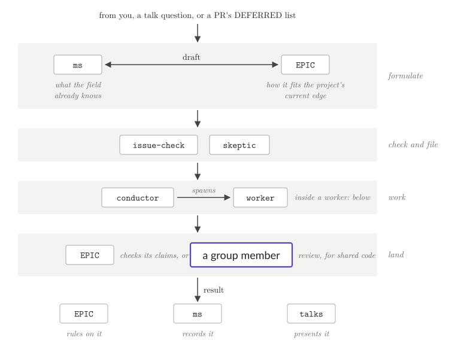
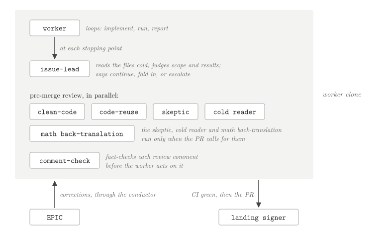
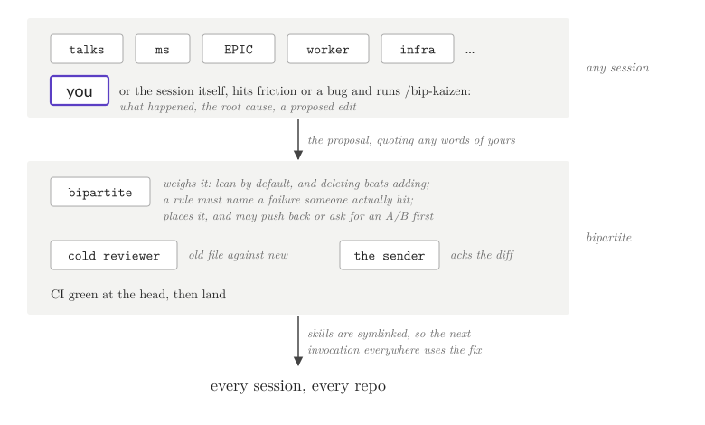

# Driving Science with a Fleet of Agents

In tier 4 you drive the science, and a fleet of agents helps.
The agents implement ideas and report back what they find.
You turn their results into slides and present them to your group, and the group's questions drive the next work.
The manuscript session ties each result to the literature, and the goal is to improve what the field knows.

The talks are the new piece, so we call this talk-driven development.
Once a result is worth keeping, its analysis is moved into the project's main branch.
The [June post](https://matsen.group/general/2026/06/06/bipartite.html) described manuscript-driven development. The manuscript still matters, but now the talk drives the work.
Talks match how scientists already work, and they bring people back into the room.

This page has four diagrams. The first shows the whole system. The other three zoom in on an issue, a worker, and a fix to the skills.
In all four, people are in a humanist face with a purple outline, and agents are in typewriter.
The literature is in a dashed box, because it is knowledge, not a person or an agent.

## The whole system

Read the upper four layers from the bottom up. Each is a wider circle that has to understand and accept a result.
Tier 3 introduced the EPIC, conductor and worker sessions; [Agent Roles](roles.md) says what each role owns.

- **Research.** The agents implement ideas and report back what they find. The EPIC session (`/bip-epic`) holds the current edge of one research question. The conductor (`/bip-conductor`) spawns a worker for each issue. The manuscript session (`/bip-ms`) stores each result with how it relates to prior work.
- **You.** Most of the work happens here, between you and the talks session (`/bip-talk`). Together you turn results into slides, and you have to understand each result well enough to explain it. A `/bip-helper` does the figure and deck work, so the talks session stays free to answer you.
- **The group.** You present the slides, and the group's questions come back. The talks session writes each question into the talk's `feedback.md`. It answers each one with a reproducible exploratory analysis, or sends it to the EPIC session as a draft issue.
- **The field.** The literature is the field's state of knowledge, and the goal is to improve it. The manuscript session reads the literature in. People write the paper that goes back out. The manuscript session keeps the results that the paper is built from, but it does not write the paper's prose.

The support layer holds no results. It keeps the other layers running.

- Staff (`/bip-staff`) holds your rulings word for word. It answers what it can and pages you for the rest.
- A sysadmin session, which has no skill of its own, watches the machine, and an infra session (`/bip-infra`) watches the cluster.
- A librarian session (`/bip-librarian`) triages literature alerts and asks the EPIC owners about the few that matter.
- A bipartite session, started in this repo, lands fixes to the skills (see [Kaizen](#kaizen)).

## The life of an issue

Many agents look at one issue before it lands.
An issue starts from you, a talk question, or the follow-ups a PR lists as deferred.
Before it is filed, its draft goes to two sessions:

- The manuscript session knows what the field knows. It can say whether published work already predicts the answer.
- The EPIC session knows the project's current edge. It can say how the issue fits the work in flight.

`/bip-issue-check` then reviews the draft, a skeptic agent looks for flaws in its plan, and the issue is filed.
The conductor spawns a worker for it.
A self-contained PR lands after the EPIC session checks the claims it makes; a PR that changes shared code needs a review from a group member.
The result goes back to the EPIC session, which rules on it, to the manuscript session, which records it, and to the talks session, which presents it.
[Issue Lifecycle](issue-lifecycle.md) gives the skills in order.

## Inside a worker

A worker owns one issue in one clone.
It loops: implement, run, report.
At each stopping point it spawns an issue-lead, which reads the files cold, with none of the worker's context. The issue-lead judges scope and results, and says whether to continue, fold deferred work in, or escalate.
Before merge, `/bip-pr-review` runs its review agents in parallel. clean-code checks naming and function size, and code-reuse looks for existing code the PR could use. The skeptic runs only when the PR makes a scientific claim, the cold reader reads a rendered notebook as its audience would, and runs only when the PR adds one, and the math back-translation runs only for a PR with formulas or scientific computation. The math back-translation restates the code's math in LaTeX, checks it against the paper the method comes from, and posts it to the PR.
`/bip-comment-check` fact-checks each review comment against the code before the worker acts on it.
The EPIC session sends corrections through the conductor, so the message and the clone's log of work stay in step.
Once CI is green at the PR's head, the PR goes to its landing signer: the session or person who signs off the landing.

## Kaizen

You, or the session you are working in, can hit friction or a bug.
Run `/bip-kaizen` there, or the session runs it itself. It writes what happened, the root cause, and a proposed edit.
A change to a project's own files is made in place. For a change to bipartite, the session sends the proposal to the bipartite session and quotes any words of yours.
The bipartite session weighs it, places it in the right file, and is lean by default: a rule must name a failure someone actually hit, and deleting beats adding.
It may push back, or ask for an A/B test first.
A cold reviewer compares the old file with the new one, and the session that sent the proposal approves the diff.
The fix lands once CI is green at the PR's head.
The skills directory is symlinked into `~/.claude/skills`, so every session in every repo uses the fix from its next skill invocation.
